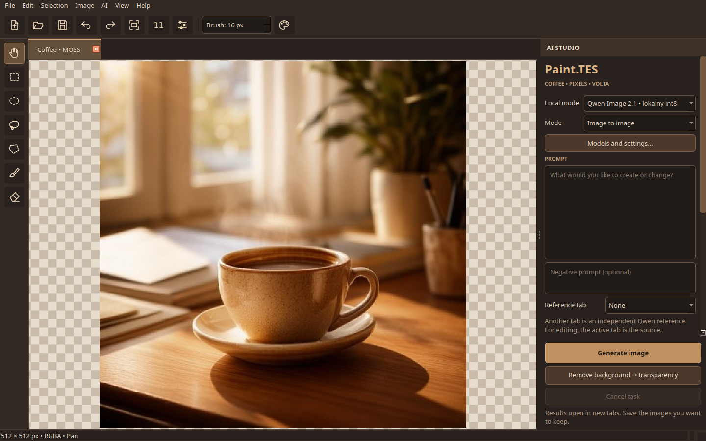

# Paint.TES

A native image editor for Ubuntu and derivatives, with local AI generation on
NVIDIA V100, V100S and TITAN V GPUs. Paint.TES combines a Paint.NET-inspired
workspace, a coffee-colored theme and an integrated AI panel.



## Features

- Text to image, image to image, inpainting and outpainting.
- Tabbed documents, with AI results opening in separate tabs.
- Reference images from other tabs, including independent references for
  Qwen-Image 2.1 and FLUX.3, and style references for Krea 2 with a compatible LoRA.
- Rectangle, ellipse, lasso and polygon selections, mask inversion and feathering.
- Brush, eraser, clipboard, crop, rotation, resizing and undo.
- Background removal to transparent PNG using a local ONNX model.
- Named model profiles with local file selection and optional LoRA.
- Exact integer seeds, last-seed reuse and adjustable denoising strength for editing.
- English and Polish interfaces, with English as the default.

Model weights stay on your disk. Generation runs locally without a cloud account
or API key. Paint.TES does not download model weights.

## Model families

| Family | Local components |
|---|---|
| Stable Diffusion 1.5 / SDXL | Complete base `.safetensors` checkpoint with text encoder and VAE |
| Qwen-Image 2.1 | Diffusion model, matching Qwen3-VL encoder and VAE |
| MOSS-Image | Diffusion model, matching Qwen3.5 encoder and Flux2 VAE |
| FLUX.3 Image Klein / Base | Diffusion model, Qwen3-VL-4B encoder and Flux2 VAE |
| Z-Image / Turbo | Diffusion model, Qwen3-4B encoder and Flux VAE |
| Krea 2 Raw / Turbo | Diffusion model, Qwen3-VL-4B encoder and original Qwen-Image VAE |
| Background removal | Local U2Net, ISNet or BiRefNet ONNX model |

FLUX.3 also supports an optional local Qwen3.5-9B prompt upsampler. Krea 2 style
references require a compatible style-reference LoRA.

Use ComfyUI-native `.safetensors` components or supported quantizations with
ComfyUI metadata. Raw GGUF, SDNQ, generic GPTQ, Diffusers directories and unfinished
downloads are not supported. Masked editing uses base models rather than dedicated
inpainting checkpoints with additional input channels.

See [model components and defaults](docs/MODELS.md) for details.

## Requirements

- Ubuntu 24.04 or a compatible derivative, x86_64.
- NVIDIA V100, V100S or TITAN V with Volta `sm_70` support.
- A working proprietary NVIDIA driver compatible with CUDA 12.6 and Volta.
- Python 3.12, Git and [uv](https://docs.astral.sh/uv/getting-started/installation/).
- Compatible local model weights and sufficient RAM, VRAM and disk space.

## Installation

```bash
git clone --recurse-submodules https://github.com/GizmoR13/Paint.Tes.git
cd Paint.Tes
./setup.sh
./install-desktop.sh
./start.sh
```

The installer creates an isolated `../.venv` next to the repository. Dependencies
are pinned in `constraints-tested.txt`, including PyTorch 2.11.0 and torchvision
0.26.0 with CUDA 12.6 and `sm_70` support. Set `PAINT_TES_VENV` to override the
virtual environment path.

Qt requires the usual Ubuntu desktop libraries, including `libxkbcommon-x11-0`
and `libegl1`. If `libxcb-cursor0` is missing, the installer extracts it into a
private `../qt-runtime` directory without sudo.

## Getting started

1. Open **Settings → Local models**, add a profile and select its local files.
2. Choose your Volta GPU and model/output directories in **Settings → General**.
3. Select the model profile and generation mode in the AI panel.
4. Create or open an image, enter a prompt and generate. Use a selection for
   inpainting, or expand the canvas for outpainting.
5. Save the results you want to keep.

Switch the interface language in **Settings → General → Language**. Configure
background removal separately by selecting a local ONNX model in Settings.

[English user guide](docs/USER_GUIDE.md) · [Polish user guide](docs/INSTRUKCJA.md)

## Local engine

The PySide6 interface uses a pinned [ComfyUI](https://github.com/Comfy-Org/ComfyUI)
submodule. The engine starts on demand in a private process on a loopback port,
independently of other ComfyUI installations.

The Volta execution path uses safe FP32 precision, math SDPA and standard memory
offloading. FP16 is optional for SD/SDXL. GPU selection uses UUIDs; multiple cards
do not automatically combine their memory.

## Validation

The application has 89 passing automated tests. An additional check validates
30 workflows against the pinned ComfyUI engine on V100, including latent shapes
and reference conditioning. Real generation has been tested with Qwen-Image 2.1
and MOSS-Image. Full generation with FLUX.3, Z-Image, Krea 2 and SD/SDXL remains
unverified; workflow validation alone does not verify model weights or output
quality. See the [validation report](docs/VALIDATION.md) for scope and limitations.

## License

GPL-3.0-or-later. ComfyUI, PySide6/Qt and other dependencies retain their respective
licenses. Paint.TES contains no Paint.NET code or assets.
